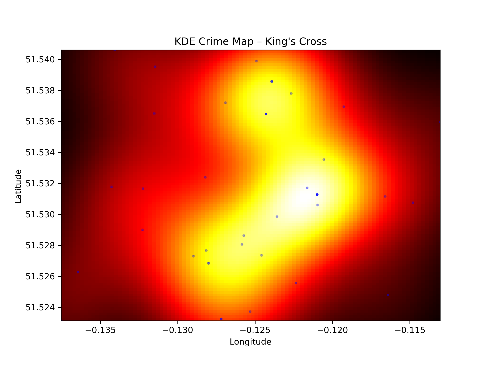

# Crime Mapping Interface

A command-line tool that retrieves street-level crime data from the UK Police API for chosen London neighbourhoods and visualises crime hotspots as kernel density estimation (KDE) heatmaps.

Built for the *Programming for Crime Scientists* module at UCL.

## What it does

1. Takes a list of Metropolitan Police neighbourhoods, a year, a month and a crime category from the user (with input validation).
2. Looks up each neighbourhood's ID and boundary via the Police API.
3. Builds a bounding box around each boundary and requests crimes inside it for the chosen month.
4. Saves the results (neighbourhood, category, latitude, longitude) to CSV.
5. Generates a KDE heatmap per neighbourhood with the individual crime locations overlaid, saved as a PNG.

## Example output

    Neighbourhood,Category,Latitude,Longitude
    King's Cross,burglary,51.524448,-0.118765
    King's Cross,burglary,51.528267,-0.124216

## Tech used

Python, `requests`, `pandas`, `numpy`, `scipy` (`gaussian_kde`), `matplotlib`, UK Police Data API

## How to run

    pip install requests pandas numpy scipy matplotlib
    python interface.py

Follow the prompts, e.g. neighbourhood `Camden Town`, year `2025`, month `09`, category `robbery`.

## Limitations

- Neighbourhoods are matched by exact name against the Metropolitan Police API, so spelling matters.
- Each neighbourhood is approximated by a bounding box, so results can include crimes just outside the true boundary.
- Heatmaps are plotted in longitude/latitude without a basemap.

## What I learned

Working with an external API meant handling failed requests and inconsistent naming, and working out how to turn boundary coordinates into the polygon format the API expects.
